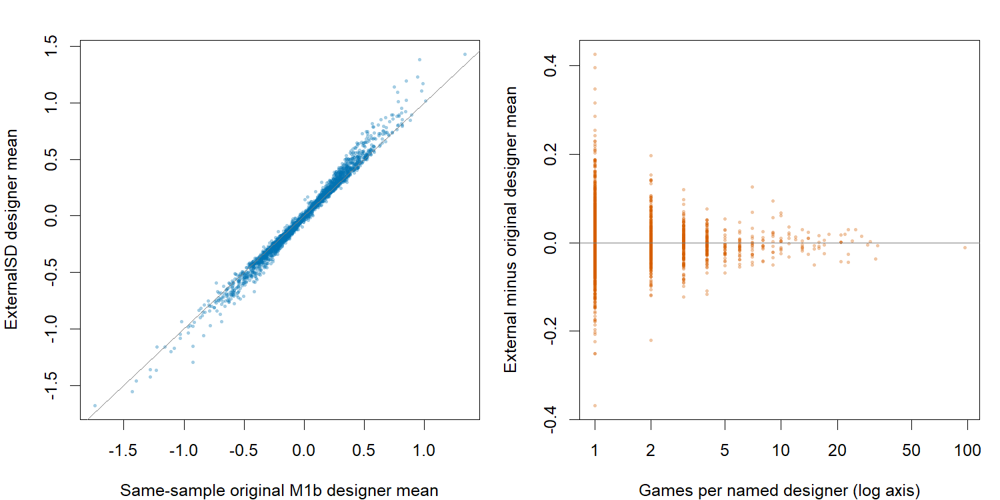
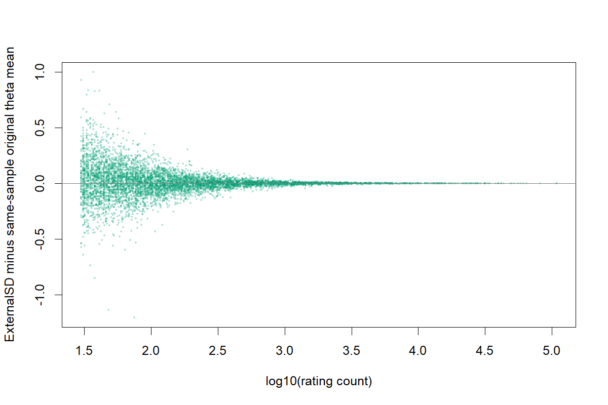

# P4: same-sample M1b versus M1b-ExternalSD

Executed 2026-11-24; primary contrast uses identical 6,416 development games, design and designer map.
ExternalSD changes only shared s²/n to fixed sd_hist²/n and removes s/prior. Constant tau and remaining priors are unchanged.
Original 6,489-game results and WAIC share remain preserved. No three-model WAIC is computed here.

See [specification, provenance and reproduction](../../../docs/P4_EXTERNALSD.md), [matching audit](matching_audit.csv), [historical SD](historical_sd_matched.csv) and [source hashes](source_manifest.csv).

## Full-chain diagnostics and resources

| Run | Draws/chain | Max R-hat | Min bulk/tail ESS | Max mean MCSE/SD | All pass | Seconds | Peak working set MiB |
|---|---:|---:|---:|---:|---|---:|---:|
| matched_baseline | 4000 | 1.0018 | 1533 / 3001 | 0.0256 | TRUE | 1374.9 | 3336 |
| external_sd | 4000 | 1.0009 | 1321 / 2414 | 0.0276 | TRUE | 1329.9 | 3348 |

Time includes compile/adapt/burn/sample and batch diagnostics; exports occur afterward. Working-set peaks are observed samples, not an absolute RAM bound.

## Scale changes (ExternalSD minus same-sample original)

| Parameter | Original mean [95% interval] | External mean [95% interval] | Mean change | MCSE of mean change |
|---|---|---|---:|---:|
| alpha | 6.3723 [6.3273, 6.4177] | 6.3769 [6.3299, 6.4246] | 0.0046 | 0.0003 |
| s | 2.9816 [2.9327, 2.9996] | removed [removed, removed] | removed | removed |
| sigma_d | 0.4331 [0.4061, 0.4597] | 0.4645 [0.4372, 0.4912] | 0.0314 | 0.0005 |
| tau | 0.4175 [0.4014, 0.4337] | 0.4732 [0.4581, 0.4890] | 0.0558 | 0.0003 |

## Main standardized covariates

| Term | Original mean [95% interval] | External mean [95% interval] | Change MCSE |
|---|---|---|---:|
| log1p_n | 0.2213 [0.2040, 0.2383] | 0.2108 [0.1931, 0.2284] | 0.0001 |
| log1p_age | -0.3814 [-0.4006, -0.3618] | -0.3830 [-0.4023, -0.3632] | 0.0001 |
| log1p_play | 0.1613 [0.1386, 0.1840] | 0.1619 [0.1386, 0.1850] | 0.0001 |
| minplayers | -0.0069 [-0.0255, 0.0115] | -0.0104 [-0.0292, 0.0086] | 0.0001 |
| maxplayers_capped | -0.0189 [-0.0364, -0.0016] | -0.0166 [-0.0339, 0.0011] | 0.0001 |
| minage | 0.0553 [0.0355, 0.0754] | 0.0559 [0.0352, 0.0764] | 0.0001 |

All coefficient magnitudes, directions and interval changes: [coefficients.csv](comparison/coefficients.csv).
Per-designer mean/95% interval/MCSE and number of training games: [designer_effects.csv](comparison/designer_effects.csv). Effects are associations, not causal contributions.

There are 3,192 named groups: 2,307 with one game and 885 repeated groups. The median absolute change in designer posterior means is 0.0167 rating points; the largest changes occur in single-game groups (maximum 0.4264). [Grouped summaries](comparison/designer_groups.csv) separate one-game and repeated groups.

The main continuous slopes retain their mean directions. log1p_n decreases from 0.2213 to 0.2108; the small maxplayers_capped interval changes from excluding zero to including zero. The only mean sign flip is missing_minplayers, with wide intervals spanning zero in both models.
The control s mean is 2.9816, near its preserved upper prior bound of 3. This contrast therefore includes the consequences of that original prior constraint; it is not a comparison with the prior-upper-6 sensitivity fit.

tau increases by 0.0558 and sigma_d by 0.0314. These changes exceed Monte Carlo mean error, while the model-specific credible intervals describe posterior uncertainty and are not a paired effect test.

## Latent ratings and shrinkage

Means and their MCSE below use the same 125 evenly-spaced retained rows per chain (500/model). Full 1,000-draw latent exports are also retained locally. MCSE describes numerical precision, not scientific effect uncertainty.

| Group | Games | Median absolute theta change | Original median absolute adjustment | External median absolute adjustment | Median change MCSE |
|---|---:|---:|---:|---:|---:|
| all | 6416 | 0.0400 | 0.0549 | 0.0134 | 0.0024 |
| n30_40 | 778 | 0.1329 | 0.2135 | 0.0710 | 0.0085 |
| n30_100 | 2780 | 0.0994 | 0.1541 | 0.0467 | 0.0061 |
| n100_200 | 1196 | 0.0521 | 0.0693 | 0.0161 | 0.0032 |
| n1000_5000 | 661 | 0.0038 | 0.0046 | 0.0008 | 0.0002 |
| n5000plus | 222 | 0.0007 | 0.0008 | 0.0001 | 0.0000 |

## Development PPC

| Run | Group | Mean within 95% predictive interval | Variance within 95% predictive interval |
|---|---|---|---|
| matched_baseline | n30_40 | FALSE | FALSE |
| matched_baseline | n100_200 | TRUE | TRUE |
| matched_baseline | n1000_5000 | TRUE | TRUE |
| matched_baseline | n5000plus | TRUE | FALSE |
| external_sd | n30_40 | TRUE | FALSE |
| external_sd | n100_200 | TRUE | TRUE |
| external_sd | n1000_5000 | TRUE | FALSE |
| external_sd | n5000plus | TRUE | FALSE |

Intervals and observed values: [PPC_comparison.csv](comparison/PPC_comparison.csv). These condition on named training designer effects and use development data; they are not holdout performance. Passing chain diagnostics does not prove model adequacy.

For n=30–40, ExternalSD moves the replicated mean interval toward the observed mean (6.162 is inside [6.065,6.165], versus the original [6.027,6.141]). Both still underpredict the observed variance 1.145; ExternalSD's interval [0.866,1.032] is farther below it than the original [0.939,1.129].
For n>5000, both overpredict variance: observed 0.365, original interval [0.419,0.574], ExternalSD [0.467,0.647]. ExternalSD also overpredicts variance in n=1000–5000, where the original interval contains the observed variance. These mixed PPC results do not establish overall improvement.

## Files and reproduction

Each run directory contains train_game_ids.csv, designer_mapping.csv, model.bug, chain_configuration.csv, diagnostics.csv, progress.csv, memory_samples.csv and scale trace/ACF/joint PNGs.
Only these two explicitly named binary shares are uploaded:

- [Matched original 500×6416 loglik](matched_baseline/pointwise_loglik_share.rds)
- [ExternalSD 500×6416 loglik](external_sd/pointwise_loglik_share.rds)

Each RDS contains ids, draw_index (real chain and 1-based retained row), loglik (draws×games), convention, train_md5, model and source_manifest. No raw JAGS iteration numbering is invented. These files must not replace the old 6489 share or be numerically compared to its WAIC.
For both, theta is integrated, named training effects conditioned, independent anonymous effects integrated as extra sigma_d². The observed unit is game-average rating conditional on n/X. This is not unseen-designer-group extrapolation.
Local-only ignored RDS: inputs, preprocessing, settings, chain_1–4 (complete parameters and RNG state), full theta draws and 1000-row pointwise likelihood, plus joint balanced theta draws. They can be regenerated using the documented sequence; CSV summaries cannot reconstruct a joint posterior.
[Export verification](comparison/verification.csv), [independent replay](final_validation.txt) and per-run export_validation.txt record numerical checks and reread. [file_manifest.csv](file_manifest.csv) records actual sizes/SHA256 and upload/local-only status for all new RDS artifacts. Input data hashes are in source_manifest.csv. postprocessing_sources.csv records the later comparison/report code separately.

## Limits

Historical SD is fixed, in rating units, with unverified acquisition date and no propagated SD estimation uncertainty. Median/max rating-count mismatch is 0.3%/62.3%; this may reflect temporal differences. Current users_rated is always the variance denominator.
Only 6416 matched development games are modeled; 73 were excluded. The original 6489 parameter file is supplementary and also uses different standardization. Do not attribute across-sample differences to historical SD alone.
Constant tau, first-listed-designer grouping, imputation and full-table P1 tag-selection caveats remain. Original simulated theta interval undercoverage is not erased by this extension. No component-specific causal explanation or predetermined ExternalSD improvement is warranted.
