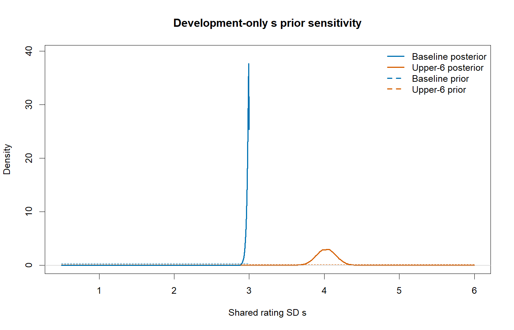
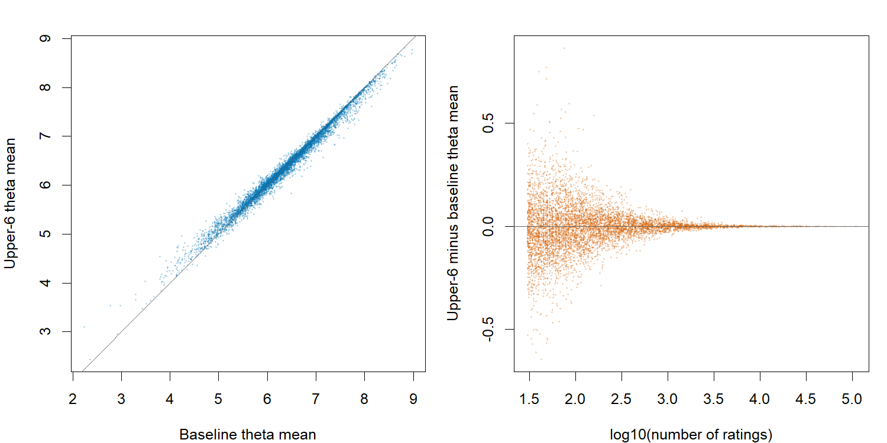

# P4 — M1b development fit and diagnostic evidence

See the [three milestone delivery checklist and clean-clone instructions](../../docs/P4_DELIVERY.md) before attempting reproduction. All RDS and source snapshots mentioned below are local-only and are not GitHub downloads.

Updated 23 November 2026. Baseline retains constant tau and every prior in P4_BASELINE.md.
Sensitivity is separately labeled: only the s prior changes from U(0.5,3) to U(0.5,6).
All 6,489 development games are used; no holdout tuning/scoring or formal cross-team model comparison was performed.

**Interpretation:** Numerical shrinkage and variance allocation materially depend on the baseline s upper bound. The relaxed prior is a sensitivity result, not a replacement baseline.
Median absolute adjustment increases from 0.0555 to 0.0989 rating points (78%).
Mean-effect directions are more robust: all 26 of 26 baseline coefficients whose 95% intervals exclude zero retain their direction. This does not assert that every interval or coefficient magnitude is unchanged.
The same low-count mean and high-count variance PPC discrepancies remain; no pristine test-set or global-ranking claim follows.

## Full-fit diagnostics

R-hat is rank-normalized/folded split R-hat; ESS is bulk/tail ESS from posterior.
Targets are R-hat <=1.01, both ESS >=400, and MCSE(mean)/posterior SD <=0.05 for all monitored quantities.

| Run | Draws/chain | Max R-hat | Min bulk ESS | Min tail ESS | Max MCSE/SD | All pass |
|---|---:|---:|---:|---:|---:|---|
| baseline_development | 4000 | 1.0012 | 1457 | 2470 | 0.0263 | TRUE |
| sensitivity_s_upper6 | 4000 | 1.0054 | 1377 | 3006 | 0.0270 | TRUE |

## Scale posterior and sensitivity

| Run | Parameter | Mean | 95% interval | R-hat | Bulk ESS | Tail ESS | Mean MCSE |
|---|---|---:|---|---:|---:|---:|---:|
| baseline_development | tau | 0.4175 | [0.4014, 0.4341] | 1.0009 | 2121 | 4169 | 0.0002 |
| baseline_development | sigma_d | 0.4403 | [0.4132, 0.4671] | 1.0007 | 1571 | 2567 | 0.0003 |
| baseline_development | s | 2.9807 | [2.9302, 2.9995] | 1.0005 | 3955 | 4583 | 0.0003 |
| sensitivity_s_upper6 | tau | 0.3752 | [0.3565, 0.3949] | 1.0040 | 2047 | 3986 | 0.0002 |
| sensitivity_s_upper6 | sigma_d | 0.3957 | [0.3665, 0.4239] | 1.0035 | 1377 | 3012 | 0.0004 |
| sensitivity_s_upper6 | s | 4.0263 | [3.7702, 4.2794] | 1.0013 | 1893 | 3385 | 0.0030 |

## Shrinkage and within-development ranking sensitivity

Median absolute latent-mean change: 0.0419 rating points.
Largest absolute change: 0.8644 rating points.
Within-sample Spearman rank correlation: 0.9937 ; Top 50 posterior-mean overlap: 42 /50.
Mean coefficient signs agree: 53 / 56 .

| Group | Games | Median absolute theta change | Baseline median absolute adjustment | Upper-6 median absolute adjustment |
|---|---:|---:|---:|---:|
| all | 6489 | 0.0419 | 0.0555 | 0.0989 |
| n30_100 | 2843 | 0.0849 | 0.1541 | 0.2401 |
| n101_1000 | 2763 | 0.0327 | 0.0348 | 0.0675 |
| n1000plus | 883 | 0.0033 | 0.0029 | 0.0062 |
| named | 5866 | 0.0387 | 0.0508 | 0.0912 |
| anonymous | 623 | 0.0772 | 0.1099 | 0.1935 |

These are within-development comparisons; they are not out-of-sample model selection, global BGG ranks, or causal effects.
Small per-game mean/rank differences retain Monte Carlo error from the 1,000 selected parameter draws.

## Main standardized covariates

| Term | Baseline mean [95% interval] | Upper-6 mean [95% interval] |
|---|---|---|
| log1p_n | 0.2204 [0.2029, 0.2377] | 0.2262 [0.2090, 0.2430] |
| log1p_age | -0.3890 [-0.4084, -0.3699] | -0.3881 [-0.4074, -0.3689] |
| log1p_play | 0.1616 [0.1389, 0.1844] | 0.1630 [0.1402, 0.1857] |
| minplayers | -0.0093 [-0.0279, 0.0091] | -0.0060 [-0.0244, 0.0125] |
| maxplayers_capped | -0.0208 [-0.0379, -0.0034] | -0.0224 [-0.0395, -0.0052] |
| minage | 0.0570 [0.0364, 0.0775] | 0.0570 [0.0365, 0.0773] |

## Development posterior predictive checks

These checks condition on training data and named designer effects; they are not holdout validation.

| Run | Rating-count group | Mean in 95% predictive interval | Variance in 95% predictive interval |
|---|---|---|---|
| baseline_development | n30_40 | FALSE | FALSE |
| baseline_development | n100_200 | TRUE | TRUE |
| baseline_development | n1000_5000 | TRUE | TRUE |
| baseline_development | n5000plus | TRUE | FALSE |
| sensitivity_s_upper6 | n30_40 | FALSE | TRUE |
| sensitivity_s_upper6 | n100_200 | TRUE | TRUE |
| sensitivity_s_upper6 | n1000_5000 | TRUE | TRUE |
| sensitivity_s_upper6 | n5000plus | TRUE | FALSE |

Baseline already shows low-count mean and high-count variance discrepancies; MCMC convergence is not model adequacy.

## Actual full-run resources

| Run | Monitored elapsed seconds | Peak aggregate working set MB | Max sum of process peaks MB | Minimum available RAM MB |
|---|---:|---:|---:|---:|
| baseline_development | 1276.8 | 3248 | 4148 | 5361 |
| sensitivity_s_upper6 | 1300.9 | 3243 | 4152 | 5575 |

Elapsed includes compile/adaptation/burn-in, sampling and batch diagnostics; latent export occurs afterward.
Working set is sampled every two seconds. Sum of individual process peaks is a conservative sum, not a simultaneous peak.

## Implementation evidence and limitations

- Original [400-game smoke record](smoke_record_README.md) and all original smoke files are retained.
- [Extended 400-game diagnostics](extended_400/diagnostics.csv) meet targets at 8,000 new draws/chain; restart semantics are documented.
- [Two full-structure simulations](simulation/recovery_overview.csv) recover scales/slopes/designer effects reasonably and reduce latent RMSE, but theta interval coverage is only 84–88% versus 95% oracle conditioning. Passing MCMC diagnostics does not resolve this calibration limitation.
- Development has 901 repeated named designer groups (3,546 games), 2,320 singleton designers and 623 anonymous games. About half of all same-designer pairs come from the ten largest groups.
- Shared s and constant tau are model assumptions; s-upper-6 is an explicitly relaxed boundary stress test, not a replacement baseline or a claim that all allowed SD values are physically plausible.
- Numeric preprocessing is re-estimated and saved on each actual training sample; fixed P1 tag columns retain their documented full-table selection caveat.
- Each formal directory contains training IDs, mapping, recipe, model, run settings, source snapshot/hashes, per-chain parameter/RNG state RDS, diagnostics, scale plots, latent draws and theta-integrated/designer-conditional log likelihood. Binary files remain local and Git-ignored.
- The posterior overwrite guard protects samples. The delivery wrapper now refuses existing formal runs before opening logs; use a new directory via M1b_reproduce.R.

See [baseline decisions](../../docs/P4_BASELINE.md), [diagnostic notes](../../docs/P4_DIAGNOSTIC_NOTES.md), [commands](../../code/P4/README.md), and [final artifact verification](resources/final_verification.csv).
